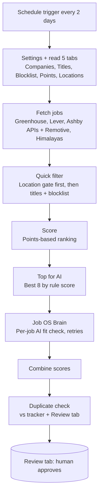

# Job OS

Job OS is a modular, n8n-based job search system. Each milestone is a self-contained workflow that shares one set of user inputs (CV, profile, Search Settings).

| Milestone | Status | Purpose |
|---|---|---|
| **M1 – Capture** | Released | Capture roles into a tracker sheet with structured fields. |
| **M2 – Auto-search** | Released | Scheduled search across job boards and company ATS pages, filtered through a deterministic rules funnel, then an AI fit check. |
| **M3 / M4** | Coming | Build on the same inputs and tracker. |

## M1 – Capture

Paste a job link into the Google Sheet and click "Process new jobs". Rules extract company, title, location and work type; the AI writes a short summary and notes anything the rules missed; the full job description is saved as a Google Doc so it survives an expired link. Files: `workflows/job-tracker.json`, `workflows/job-os-brain.json` (import the brain first).

## M2 architecture



## Repository layout

```
workflows/                       M1 capture workflow + shared Job OS Brain
m2/
  job-search-m2.public.json      n8n workflow (placeholders: YOUR_*)
  job-os-brain.public.json       AI fit-check sub-workflow (placeholders: YOUR_*)
  code/                          Source of each Code node
  search-settings-template/      Search Settings template (xlsx + one CSV per tab)
```

## Design decisions and trade-offs

- **Rules first, AI last.** Deterministic filters are free, fast and auditable, so they remove the bulk of irrelevant listings before any model call is made.
- **AI only on the top 8.** The Gemini free tier has a tight request quota. Ranking first and sending only the top 8 keeps each run within quota while focusing AI effort where it matters.
- **Strict / flexible location gate.** In strict mode a job must be remote within an allowed scope, or list an allowed city or relocation region; unclear locations are dropped. In flexible mode location only adds points. Users change the Locations tab, never the code.
- **Dedupe on URL, job id preserved.** URLs are normalised (tracking parameters stripped), but meaningful identifiers such as Greenhouse `?gh_jid=` are kept so distinct roles are not merged.
- **Per-item AI call with retries.** Each job is assessed in its own call. A transient failure affects one item, not the batch, and retries absorb 503s and rate limits.

## Lessons from testing

Real defects found and fixed during testing:

1. **Column name mismatch** – the code expected headers that differed from the sheet; header names are now aligned and validated.
2. **Item linking** – `$('Node').item` broke pairing after fan-out; replaced with `.first()` / explicit indexing where appropriate.
3. **Gemini 503 batch failure** – one overloaded response failed the whole batch; moved to per-item calls with retry.
4. **Free-tier 429 quota** – too many calls per run; capped AI evaluation at the top 8.
5. **Location gate passing unknown places** – unrecognised locations now fail closed.
6. **"Home Based - APAC" misread** – now correctly classified as remote within a region.
7. **Board location "India" read as onsite** – country-only board locations are no longer treated as an onsite city match.
8. **Dedupe cutting `?gh_jid`** – the normaliser stripped the Greenhouse job id and merged distinct roles; it is now preserved.
9. **Himalayas only returning 20 jobs** – added targeted title searches for India-open remote roles.
10. **India office flag too loose** – tightened so only genuine in-country offices count.

## Setup

1. **CV** – keep an up-to-date CV in Google Docs/Drive.
2. **About-me profile** – write a short profile (target roles, seniority, strengths, deal-breakers) used by the AI fit check.
3. **Preferences in Search Settings** – copy `m2/search-settings-template/` into a Google Sheet and fill in roles (Titles), companies, blocklist, points, and locations, including strict/flexible and willingness to relocate.
4. **Connect Google Sheets / Docs / Drive in n8n** – create an OAuth client in Google Cloud, add yourself as a test user on the consent screen, then create the credentials in n8n. Replace `YOUR_*` placeholders (sheet IDs, credential IDs, workflow IDs) after import.
5. **AI API key** – create a Gemini API key (free tier is sufficient) and add it as an n8n credential; attach it to the Job OS Brain workflow.

> M3 and M4 reuse the same inputs (CV, profile, Search Settings, credentials), so this setup is done once.
